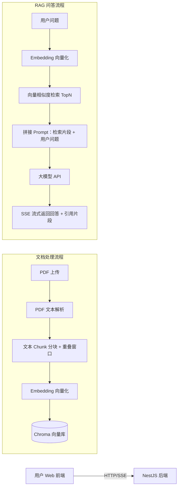

# rag-knowledge-web# RAG 私有 PDF 知识库 Web 应用

> 基于 RAG 检索增强生成，上传私有 PDF 文档，基于文档内容问答，附带引用溯源，缓解大模型幻觉。
> 项目用途：前端转 AI 应用 / 全栈面试演示项目

## 📖 项目简介

本项目是一套 Web 端私有文档问答系统。用户上传 PDF 文档，后端自动完成文档解析、文本分块、向量化并存入向量库。
用户提问时，系统检索文档中相关片段，拼接提示词交给大模型，**仅使用上传文档内容进行回答**，并展示原文引用来源。
本项目调用外部 LLM 与 Embedding API，不本地部署大模型、不做模型微调。

## ✨ 核心功能

- ✅ SSE 流式对话，打字机效果输出回答
- ✅ 会话管理：新建、切换、删除对话，历史消息持久化
- ✅ PDF 文档上传、文本解析
- ✅ 文档文本分块（Chunk）+ 重叠窗口策略
- ✅ Embedding 文本向量化，Chroma 向量库相似度检索
- ✅ RAG 检索增强问答，回答附带原文引用溯源
- ✅ 异步文档处理，大文档后台解析，不阻塞接口
- ✅ Docker + docker-compose 一键容器化部署，支持公网演示

## 🛠 技术栈

### 前端

React 18 + TypeScript + Vite + Ant Design + EventSource

### 后端

NestJS + TypeORM + SQLite + Multer + pdf-parse

### AI & 向量库

Chroma、LLM API、Embedding API

### 工程化

Git、Docker、docker-compose

## 📐 系统架构

```
用户前端页面
    ↓ HTTP/SSE
NestJS 后端
├─ 文档模块：PDF 上传 → 文本解析 → Chunk 分块 → Embedding 向量化 → 存入 Chroma 向量库
└─ 对话 RAG 模块：用户提问 → Embedding 转向量 → 向量检索 TopN 片段 → 组装 Prompt → LLM 流式 SSE 返回
```

### Mermaid 架构图



## 📁 仓库目录

```
rag-knowledge-web/
├── react-client/        # React 前端
├── nest-server/         # NestJS 后端
├── docker/              # docker-compose 配置
├── docs/                # 项目计划、踩坑日志、面试笔记
├── project-plan.md      # 三个月项目执行计划
└── README.md
```

## ⚙️ 本地开发启动

> 前置：Node >= 18，准备好 LLM 和 Embedding API Key

### 1. 后端启动

```bash
cd nest-server
npm install
# 在 nest-server 目录新建 .env，填入密钥
# LLM_API_KEY=xxx
# EMBEDDING_API_KEY=xxx
npm run start:dev
```

### 2. 前端启动

```bash
cd react-client
npm install
npm run dev
```

### 3. Docker 容器一键启动

```bash
cd docker
docker-compose up -d
```

## 📸 项目截图

> 聊天界面、文档管理页面、引用溯源效果截图（后续粘贴）

## 💡 项目亮点（面试重点）

1. 使用 SSE 长连接实现流式输出，处理连接关闭，防止内存泄漏
2. RAG 完整应用链路落地，Chunk 重叠分块策略减少上下文割裂
3. 引用溯源，可展示原文片段，降低大模型幻觉
4. 大文档采用异步后台处理，不阻塞主接口
5. 前后端 TS 统一技术栈，Nest 模块化分层，代码结构清晰
6. 支持 Docker 容器化部署，可公网在线演示

## 🚧 项目局限 & 后续优化方向（面试必问）

- 当前向量库 Chroma 适合演示项目；生产环境可替换 PGVector / Milvus
- 仅支持 PDF 纯文本解析，暂不支持图片、表格、多模态文档
- 无用户权限系统，为单用户演示项目；可扩展 RBAC 多用户权限
- 未做分片存储与分布式部署，适合中小文档量场景
- 可优化：分块策略自动调优、重排 Rerank、缓存 Embedding 减少 API 调用

## ⚠️ 注意事项

1. `.env`、上传文件、向量库、sqlite 数据库均已加入 `.gitignore`，**禁止提交密钥至代码仓库**
2. LLM、Embedding 接口会产生调用费用，开发阶段做好缓存减少请求次数
3. 本项目为学习演示项目，不用于生产环境

## 📚 项目文档

- [项目执行计划](./project-plan.md)
- [面试笔记](./docs/interview-notes.md)
- [踩坑日志](./docs/error-log.md)
